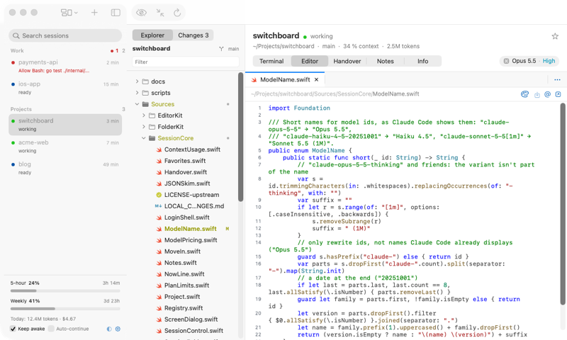
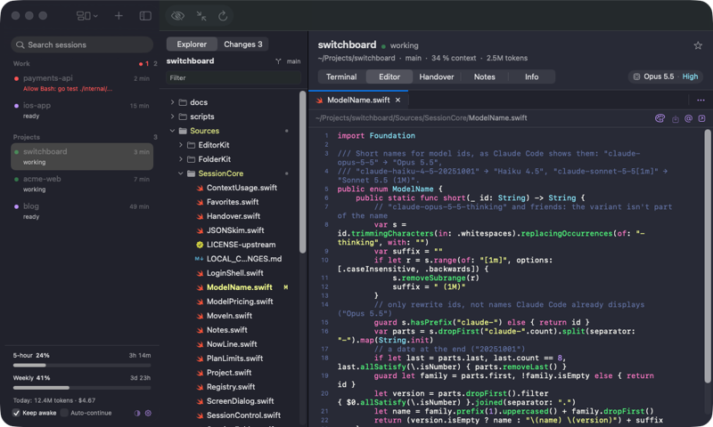
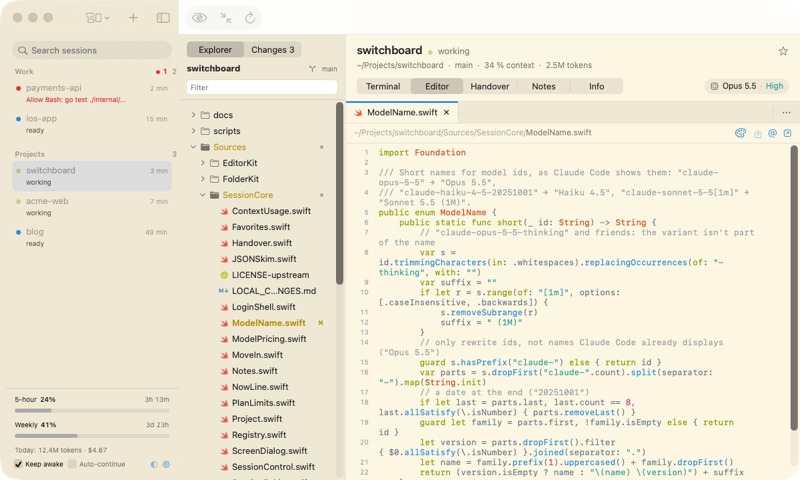
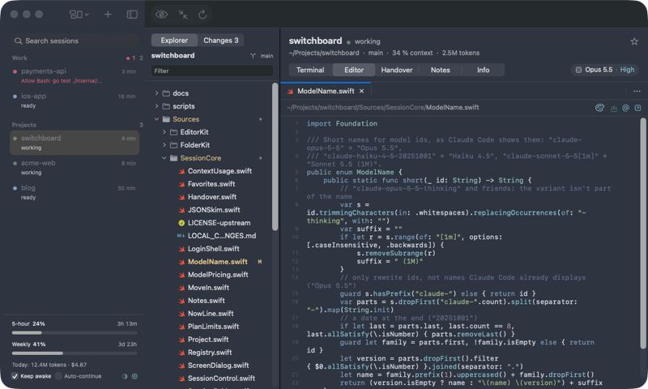

# Switchboard

**One macOS window for all your Claude Code sessions.**

[](https://github.com/HoangLong256/switchboard/actions/workflows/ci.yml)
[](https://github.com/HoangLong256/switchboard/releases/latest)


[](LICENSE)

Switchboard shows each Claude Code session on your Mac and its status. It shows the terminal of the session
that you select. It also shows the files of that session in an editor with Source Control.


> [!NOTE]
> Switchboard is an independent open source project. Anthropic does not make or support it.
> You must have your own Claude Code installation and account.

## Highlights

- **Sessions in one list.** The sessions that need you are at the top. Press ⇧⌘H to go to the next one.
- **Real terminals.** Each session runs in tmux. The session continues when you close the app.
- **Editor and Source Control.** Open, edit and compare files. Stage and commit changes.
- **Themes.** Use VS Code color themes in all of the app, the terminal included.
- **Usage limits.** See your 5-hour and weekly plan limits and the cost of each session.
- **No stops.** The Mac stays awake while sessions work. Sessions continue after a usage limit resets.
- **Sessions from other apps.** Move a session from VS Code, iTerm or Terminal into Switchboard.


## Install

You must have:

- macOS 14 or later, on Apple silicon or Intel
- [Claude Code](https://docs.anthropic.com/en/docs/claude-code) (the `claude` command)
- tmux (install it with `brew install tmux`)

Do these steps:

1. Download `Switchboard-<version>.dmg` from the [latest release](../../releases/latest).
2. Open the file.
3. Drag Switchboard to the Applications folder.
4. Open Switchboard. macOS stops the app the first time, because it does not have an Apple Developer ID.
5. Click **Done**.
6. Open System Settings → Privacy & Security.
7. Click **Open Anyway**.

You can also do steps 5 to 7 with one command:

```sh
xattr -dr com.apple.quarantine /Applications/Switchboard.app
```

## Quick start

1. Open Switchboard. The left column shows the Claude Code sessions on this Mac.
2. Press **⌘N** to start a new session.
3. Select a folder, then click **Create**. Claude Code starts in that folder.
4. Use the **Terminal** tab to talk to Claude.
5. Click a file in the folder sidebar to open it in the **Editor** tab.
6. Press **⇧⌘H** when a session needs you.

## Themes

 | 
:---: | :---:
Light Modern | Dracula
 | 
Solarized Light | Nord

## Documentation

| Document | Contents |
|---|---|
| [Features](docs/features.md) | All features, step by step, and the keyboard shortcuts |
| [Development](docs/development.md) | Build from source, project structure, releases |
| [Contributing](CONTRIBUTING.md) | How to send a change |
| [Privacy](docs/privacy.md) | The data that Switchboard reads and writes |
| [Troubleshooting](docs/troubleshooting.md) | Problems and their solutions |

## Credits and license

- `SessionCore` includes MIT-licensed code by TBIMYR (`Sources/SessionCore/LICENSE-upstream`).
- The terminal uses [SwiftTerm](https://github.com/migueldeicaza/SwiftTerm). Markdown uses
  [MarkdownUI](https://github.com/gonzalezreal/swift-markdown-ui).
- The theme colors come from the VS Code themes of the same names. The file icons follow Seti and Material.

Switchboard has the [MIT License](LICENSE). Claude and Claude Code are products and names of Anthropic.
