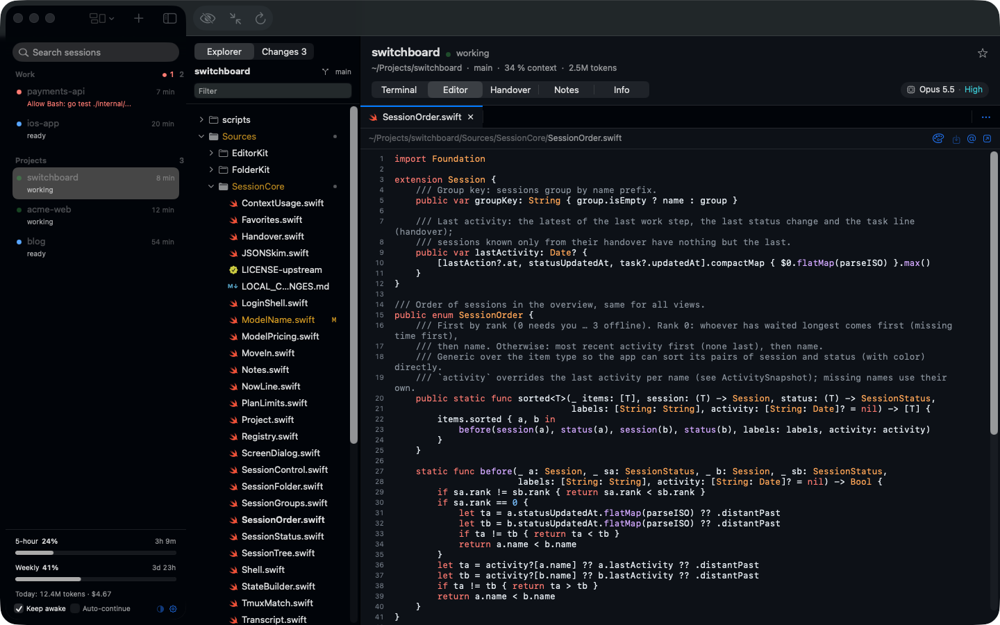
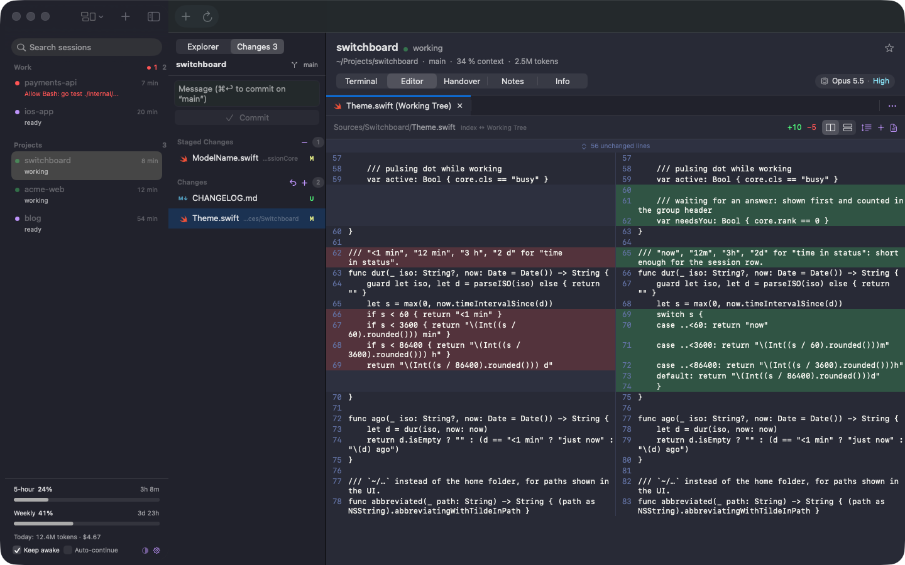

# Switchboard

**Run many Claude Code sessions side by side, from one native macOS window.**

[](https://github.com/HoangLong256/switchboard/actions/workflows/ci.yml)
[](https://github.com/HoangLong256/switchboard/releases/latest)


[](LICENSE)

Switchboard shows every Claude Code session on your Mac at a glance, with a status for each (needs you /
working / ready / offline), the selected session's real terminal, a folder sidebar with a VS Code-style
editor and Source Control, your plan's usage limits, and Claude Code's agent teams. It is a SwiftUI app
built as a Swift package; everything stays on your machine.

> Switchboard is an independent open source project. It is not affiliated with or endorsed by Anthropic.
> Claude and Claude Code are Anthropic's products; you bring your own Claude Code install and account.



## Why Switchboard

Once you run more than two or three Claude Code sessions, the terminal tabs stop scaling. You lose track of
which one is waiting for an answer, which one hit a usage limit an hour ago, and which folder each one is in.
Switchboard puts that back in view:

- **One list, sorted by what needs you.** Each session has a status dot, its tokens, and its model and
  effort. ⇧⌘H jumps to the next session that is waiting.
- **The real terminal, not a replay.** Every session runs in Switchboard's own tmux server, so it survives
  the app closing and you can attach from any terminal with `tmux -L switchboard attach`.
- **The code next to the conversation.** A live folder tree, a VS Code-style editor with themes, diffs,
  and stage / commit, without leaving the window.
- **It keeps sessions moving.** The Mac stays awake while sessions work, and sessions that stopped at a
  usage limit continue when the limit resets.
- **Adopt sessions started elsewhere.** Sessions from VS Code, iTerm or Terminal are listed too; **Move
  into Switchboard** continues the same conversation in Switchboard's terminal.

## Install

Requirements: macOS 14 or newer (Apple silicon or Intel), [Claude Code](https://docs.anthropic.com/en/docs/claude-code)
(`claude`) and tmux:

```sh
brew install tmux
```

1. Download `Switchboard-<version>.dmg` from the [latest release](../../releases/latest).
2. Open it and drag Switchboard to Applications.
3. **First launch only.** The app is ad-hoc signed, not signed with an Apple Developer ID, so macOS blocks it
   once. Open it, choose **Done**, then go to System Settings → Privacy & Security and click **Open Anyway**.
   Or clear the quarantine flag in Terminal instead:

   ```sh
   xattr -dr com.apple.quarantine /Applications/Switchboard.app
   ```

Prefer to build it yourself? See [Build from source](#build-from-source).

## Quick start

1. Launch Switchboard. Every Claude Code session already on this Mac appears in the left column, read from
   `~/.claude`.
2. Press **⌘N** for a new session: pick a folder, and Switchboard starts a tmux session that runs
   `claude -n <name>` (the name defaults to the folder's name).
3. Talk to Claude in the **Terminal** tab. Open files from the folder sidebar in the **Editor** tab; drag a
   file onto the terminal (or *Insert @Path into Terminal*) to hand it to Claude.
4. When a session needs you, its dot changes and it moves up the list. **⇧⌘H** takes you there.
5. Optional: click the usage bars at the bottom of the sessions column and choose **Set Up Live Status
   Line…** to get live plan limits, context and cost per session (details under [Usage](#usage)).

## Features

### Sessions

- Every Claude Code session on this Mac, read from `~/.claude/sessions`, the transcripts and handovers.
  Sorted by what needs you first, favorites on top. Each row shows a status dot (needs you / working / ready
  / offline) and its tokens.
- Search, a context menu, and ⌘N for a new session: a tmux session that runs `claude -n <name>` right away
  (or only types the command in, if you turn off *Start Claude right away*).
- **Grouping** by parent folder (e.g. everything under `~/Workplace/Personal Projects`) or by status, via the
  group button in the toolbar or Settings. Each group folds, and shows its size and how many sessions need
  you.
- **Sessions started elsewhere** (VS Code, iTerm, Terminal) are listed, but their terminal belongs to that
  app. **Move into Switchboard…** (Terminal tab, or the row's context menu) ends the session there, as
  closing its window would, and continues the same conversation in Switchboard's terminal
  (`claude --resume <id>`). Offline sessions have **Resume in Switchboard**.
- The **model and effort chip** ("Opus 5.5 · High") next to the tabs shows what the selected session runs
  with; click it for context and cost. It comes from the live status line, else from the transcript's last
  response.

### Terminal, Handover, Notes, Info

- **Terminal**: the session's real terminal, served by Switchboard's own tmux server (`tmux -L switchboard`).
- **Handover**: `~/.claude/handover/<name>.md`, rendered.
- **Notes**: a notepad per session, stored in `~/.switchboard/notes`.
- **Info**: folder, branch, PID, context, the "Now" line, and the last messages.

### Folder sidebar

- The selected session's working directory as a tree. It updates live as the session writes files, marks
  git changes (M / A / D / U), shows the branch, and offers a worktree picker for repositories with linked
  worktrees (`claude --worktree`).
- A filter, and a toggle for hidden files.
- **File icon themes** like VS Code's: Seti (colored glyphs per language), Material (colored folders) or
  Minimal. In Settings or View ▸ File Icon Theme. File names take their git color.

### Source Control



- Switch the folder sidebar from Explorer to **Changes**: Merge Changes, Staged Changes and Changes, with
  Stage (+), Unstage (−) and Discard (to the Trash for new files) per file or for all, and a commit box
  (⌘↩).
- A click opens the file's changes in a **diff tab**: side by side or inline, unchanged regions folded, in the
  theme's colors. Staged changes compare HEAD with the index, the others the index with the file.

### Editor

Follows the same rules as VS Code's Explorer and editor:

- A single click **previews** a file in an *italic* tab that the next preview replaces; focus stays in the
  tree. A double click or Return keeps it open and moves focus into the editor. Arrow keys only move the
  selection; Space previews.
- Editing pins the tab. Unsaved changes show a dot on the tab and a count on the Editor tab ("Editor •2").
- ⌘S saves, ⌥⌘S saves all. ⌘W closes the editor and asks Save / Don't Save / Cancel when there are changes;
  quitting with unsaved files asks too.
- Right-click a tab, or use the "…" at the end of the tab bar: Close, Close Others (⌥⌘T), Close to the
  Right, Close Saved, Close All (⌥⌘W). Unsaved files are asked about once, with Save All / Don't Save /
  Cancel.
- Files a session changes on disk reload by themselves while you have no unsaved changes. If you do, saving
  stops with **Compare / Overwrite / Revert** instead of overwriting the session's work.
- Binary, oddly encoded and very large files show a notice with **Open Anyway**. Markdown has a preview;
  images are shown directly.
- Code gets simple syntax colors (comments, strings, numbers, keywords, types, calls).

### Themes

- **VS Code themes for the whole app**: sidebars, editor, and the terminal with its 16 ANSI colors. Light /
  Dark Modern (Automatic keeps the macOS look), Dracula, One Dark Pro, Monokai, GitHub Dark / Light, Nord,
  Solarized Dark / Light.
- A theme is light or dark by itself, so it takes over from Appearance. Pick one from the palette button
  above the file, View ▸ Theme, or Settings.

### Agent teams

Claude Code's experimental agent teams (`CLAUDE_CODE_EXPERIMENTAL_AGENT_TEAMS`):

- Turn on *Agent team* in New Session to enable it for that session only.
- Teammates appear under their lead in the session list, with their color, state and current task.
- The lead's **Team** tab shows the members, the shared task board (pending / in progress / done, with
  blockers), and the messages between them.
- Read from `~/.claude/teams/<team>/` and `~/.claude/tasks/<team>/`. Split-pane teammates run as panes of
  the lead's tmux session, so they show in its terminal.

### Usage

- **Per session**: tokens over 31 days, including subagents, and their value at API list prices. The Info
  tab breaks it down, plus cost, context, model and effort as Claude Code reports them.
- **Plan limits**: 5-hour and weekly bars at the bottom of the sessions column, colored by whether you'll
  last until the reset. Click them for pace, model-specific limits, tokens per day, and the top sessions and
  projects. Works on individual Pro and Max plans.
- **Live status line**: live limits come from Claude Code's status line. **Set Up Live Status Line…** in the
  usage popover copies `switchboard-statusline` to `~/.switchboard/bin` and sets `statusLine` in
  `~/.claude/settings.json`, after asking and with a backup. The command prints a line like
  "Opus 5.5 · ctx 37% · 5h 12% · wk 40%" for Claude Code and keeps the numbers under `~/.switchboard` for
  the app.

### Keep awake

- While any session works, Switchboard holds a power assertion (like `caffeinate`) and lets go as soon as
  none does. It shows in `pmset -g assertions` as "Switchboard: 2 sessions working".
- Options to keep the display on, and to stay awake while a session waits to be continued. Use the **Awake**
  switch at the bottom of the sessions column, or Settings (⌘,). Closing the lid still sleeps a MacBook on
  battery; macOS decides that.

### Continue after usage limits

- When a session stops with Claude Code's "You've hit your session limit · resets 3:10pm" (in the
  transcript: `apiError: usage_limit_reached`), Switchboard types `continue` into it a minute after the
  reset, once per hit. The reset time comes from the message, or from the live 5-hour and weekly windows.
- The row shows "limit · continues 3:10pm". The Info tab has **Continue Now** and a per-session switch.
- Only for sessions in Switchboard's tmux server, and only if nothing was said since the limit.
- New sessions can instead start with Claude Code's own unattended retry (`CLAUDE_CODE_RETRY_WATCHDOG=1`,
  with a maximum wait). It waits at the limit inside the request and carries on by itself.

## Keyboard shortcuts

| Shortcut | Action |
|---|---|
| ⌘N | New session |
| ⇧⌘H | Next waiting session |
| ⌘J | Focus terminal |
| ⌘1 – ⌘6 | Terminal, Editor, Team, Handover, Notes, Info tabs |
| ⌘D | Toggle favorite |
| ⌘R | Refresh |
| ⌘S / ⌥⌘S | Save / Save all |
| ⌘W | Close editor |
| ⌥⌘T | Close other tabs |
| ⌥⌘W | Close all tabs |
| ⌘↩ | Commit (in Source Control) |
| ⌥⌘0 / ⌥⌘L / ⌥⌘D | Appearance: System / Light / Dark |
| ⌘, | Settings |

## Build from source

Needs macOS 14+, Xcode or the Swift 5.10 toolchain, and `brew install tmux`.

```sh
git clone https://github.com/HoangLong256/switchboard.git
cd switchboard

swift run Switchboard                                    # debug build, run from the terminal
swift run Switchboard --select blog.01 --open ~/x.swift  # preselect a session / open a file
sh scripts/bundle.sh --install                           # release build → ~/Applications/Switchboard.app
swift test                                               # folder tree, editor rules, teams, status line, tmux matching
SWITCHBOARD_TMUX=sb-test swift run Switchboard           # a separate tmux server, for trying things out
```

`sh scripts/release.sh` builds the universal (arm64 + x86_64) app and packs it as `dist/Switchboard-<version>.dmg`
and `.zip`, the same way the release workflow does.

### Data and environment

| Location / variable | Purpose |
|---|---|
| `~/.switchboard` | Switchboard's own data: status line output, notes, `bin/switchboard-statusline` |
| `~/.claude` | Read only, for sessions, transcripts, handovers, teams and tasks (`settings.json` is edited only by *Set Up Live Status Line…*, after asking and with a backup) |
| `SWITCHBOARD_TMUX` | Name of the tmux server (default `switchboard`) |
| `SWITCHBOARD_DATA` | Another folder instead of `~/.switchboard` |
| `SWITCHBOARD_HOME` | Read `.claude` from another home folder (for tests) |

## Project structure

Switchboard is one Swift package. The UI lives in a single executable target; everything with rules worth
testing is in a UI-free module with its own test target.

| Target | What it does |
|---|---|
| `Switchboard` | The SwiftUI app: session list, terminal (SwiftTerm), editor, diffs, themes, settings |
| `SessionCore` | Reads the Claude Code registry, transcripts, handovers and usage |
| `FolderKit` | Folder listing, tree and filter, git status and changes, worktrees |
| `EditorKit` | Editor tabs and documents with VS Code's preview, dirty and save-conflict rules |
| `TeamKit` | Agent teams from `~/.claude/teams` and `~/.claude/tasks` |
| `StatusLineKit` | What the status line command keeps for the app (plan limits, context, cost per session) |
| `switchboard-statusline` | The status line command Claude Code calls |

Dependencies: [SwiftTerm](https://github.com/migueldeicaza/SwiftTerm) for the terminal and
[MarkdownUI](https://github.com/gonzalezreal/swift-markdown-ui) for rendered Markdown. Tests are in `Tests/`,
one target per module (`swift test`). Automation lives in `.github/workflows/` (`ci.yml`, `release.yml`,
`auto-tag.yml`) and `scripts/` (`bundle.sh`, `release.sh`, `next-version.sh`).

## Contributing

Issues and pull requests are welcome.

1. Fork and clone, then `swift build` and `swift test`. CI runs both on every push to `main` and every pull
   request (`.github/workflows/ci.yml`, on macOS 15 runners).
2. Keep logic that has rules in a UI-free module (`FolderKit`, `EditorKit`, `TeamKit`, `SessionCore`,
   `StatusLineKit`) with a test next to it; keep `Switchboard` to views and glue.
3. Try changes against a separate tmux server so your real sessions stay untouched:
   `SWITCHBOARD_TMUX=sb-test swift run Switchboard`.
4. **Commit messages drive releases** (see below). Use `feat: …` for user-visible additions and `fix: …` for
   bug fixes; anything else (`docs:`, `ci:`, `chore:`, `refactor:`) ships with the next release but doesn't
   create one.

If you change `SessionCore`, add a line to `Sources/SessionCore/LOCAL_CHANGES.md`, which tracks how it
diverges from the upstream code it is based on.

## Releases and versioning

Versions are tagged automatically. When CI passes on `main`, **Auto Tag** (`.github/workflows/auto-tag.yml`)
reads the commit messages since the last tag, pushes the next version tag, and calls **Release**
(`.github/workflows/release.yml`), which builds the universal app on GitHub Actions and attaches the `.dmg`
and `.zip` to a GitHub release.

| Commit message | Version | Example |
|---|---|---|
| `feat: …` or `feature: …` | minor | v0.2.1 → v0.3.0 |
| `fix: …` or `bug: …` | patch | v0.2.1 → v0.2.2 |
| anything else (`docs:`, `ci:`, `chore:`, …) | no release | |

A scope works too (`feat(editor): …`), and with several commits the biggest bump wins.
`sh scripts/next-version.sh` prints what would be released. A tag pushed by hand
(`git tag v1.0.0 && git push --tags`) still releases, e.g. for a major version. Running the Release workflow
by hand (Actions ▸ Release ▸ Run workflow) only builds and keeps the app as a run artifact.

## Privacy

Everything runs on your Mac. Switchboard has no server, no telemetry and no network code: `Sources/` contains
no `URLSession` or other networking calls. What it does do locally:

- **Reads** `~/.claude` (sessions, project transcripts, handovers, teams, tasks, `settings.json`) to build the
  session list, usage and team views, and the usage cache (`cachedUsageUtilization`) from `~/.claude.json`.
- **Writes** only to `~/.switchboard` (notes, status line data), to files you save in the editor, and to
  `~/.claude/settings.json` if you choose *Set Up Live Status Line…* (after a prompt, with a backup).
- **Runs** `tmux` (its own server), `git` (status, diffs, stage, commit), and your login shell once to find
  your `PATH`. Claude Code itself runs inside the tmux session, with your own account and settings;
  Switchboard doesn't read your credentials or the Keychain.
- *Move into Switchboard* sends the other app's Claude process SIGHUP then SIGTERM, the same as closing its
  window, before resuming the conversation here.

Usage figures are computed from your local transcripts; "value at API list prices" is an estimate, not a bill.

## Troubleshooting

- **"tmux not installed"**: `brew install tmux`. Switchboard looks in `/opt/homebrew/bin`, `/usr/local/bin`
  and `/usr/bin`.
- **macOS won't open the app**: see step 3 under [Install](#install). The build is ad-hoc signed; there is no
  Developer ID yet.
- **A session's Terminal tab says "Runs in Visual Studio Code" (or iTerm, Terminal)**: it was started outside
  Switchboard's tmux server, so its terminal belongs to that app. Use *Move into Switchboard…*; offline
  sessions have *Resume in Switchboard*.
- **Plan limits don't update live**: run *Set Up Live Status Line…* from the usage popover, or check that
  `statusLine` in `~/.claude/settings.json` points at `~/.switchboard/bin/switchboard-statusline`.
- **Reset everything Switchboard stores**: delete `~/.switchboard`. Your Claude Code data in `~/.claude` is
  untouched.
- **Attach to a session from a plain terminal**: `tmux -L switchboard attach -t <name>`.

## Credits

- `SessionCore` is based on MIT-licensed code by TBIMYR. See `Sources/SessionCore/LICENSE-upstream`,
  `Sources/SessionCore/UPSTREAM_COMMIT` and `Sources/SessionCore/LOCAL_CHANGES.md`.
- Terminal rendering by [SwiftTerm](https://github.com/migueldeicaza/SwiftTerm); Markdown by
  [MarkdownUI](https://github.com/gonzalezreal/swift-markdown-ui).
- Theme palettes follow the VS Code themes they are named after (Dracula, One Dark Pro, Monokai, GitHub,
  Nord, Solarized); file icons follow the Seti and Material icon themes.

## License

Switchboard is released under the [MIT License](LICENSE). `SessionCore` includes code by TBIMYR, also under
the MIT license (`Sources/SessionCore/LICENSE-upstream`), whose notice stays with that code.

---

Switchboard is not affiliated with, endorsed by, or sponsored by Anthropic. Claude and Claude Code are
Anthropic's products and names. Agent teams and the retry watchdog are experimental Claude Code features
and may change; Switchboard reads Claude Code's local files as they are today and may need updates when
those change.
