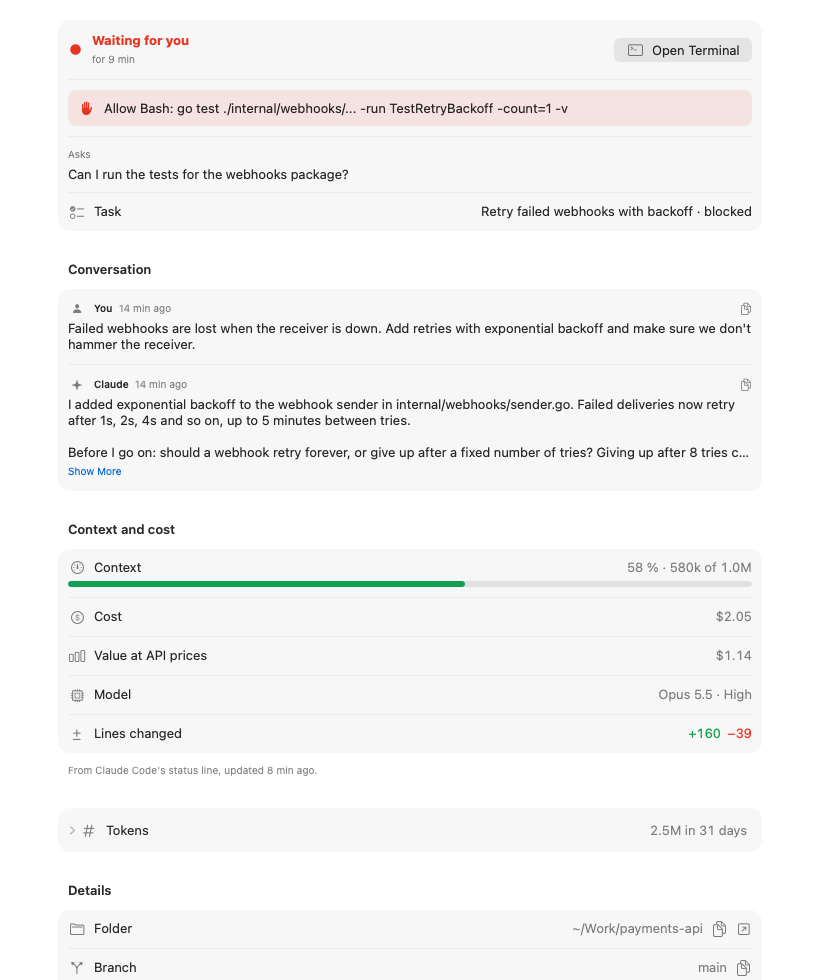

# Features

This document tells you how to use Switchboard. For installation, see the [README](../README.md#install).

- [Sessions](#sessions)
- [Session tabs](#session-tabs)
- [Answer a session](#answer-a-session)
- [Info tab](#info-tab)
- [Subagents](#subagents)
- [Handover](#handover)
- [Sessions from other apps](#sessions-from-other-apps)
- [Folder sidebar](#folder-sidebar)
- [Source Control](#source-control)
- [Editor](#editor)
- [Themes](#themes)
- [Agent teams](#agent-teams)
- [Usage and plan limits](#usage-and-plan-limits)
- [Notifications](#notifications)
- [Keep awake](#keep-awake)
- [Continue after a usage limit](#continue-after-a-usage-limit)
- [Keyboard shortcuts](#keyboard-shortcuts)

## Sessions

The left column shows all Claude Code sessions on this Mac. Switchboard reads them from `~/.claude/sessions`,
the transcripts and the handovers.

Each row shows a status dot, the time in that status, and the number of tokens:

| Dot | Status | Meaning |
|---|---|---|
| Red | Needs you | The session waits for an answer or a permission. |
| Green, pulsing | Working | Claude does work. |
| Blue | Ready | The session waits for your next message. |
| Ring | Offline | The session does not run. |

The sessions that need you are at the top. Your favorite sessions are above the other sessions.

### Start a new session

1. Press **⌘N**.
2. Select a folder. The name of the folder becomes the name of the session.
3. Change the name if necessary.
4. Click **Create**.

Switchboard starts a tmux session in the folder and runs `claude -n <name>`.

When you type `/exit`, Claude stops but the terminal stays. The session stays selected and shows the status
"Shell". Type `claude` to start again, or close the session. If the terminal closes too, Switchboard selects the
next session.

> [!NOTE]
> Turn off **Start Claude right away** to only type the command. You can then change it before you push Enter.

### Put sessions in groups

1. Click the group button in the toolbar.
2. Select **Parent Folder** or **Status**.

**Parent Folder** puts the sessions of each folder together. For example, all sessions in
`~/Workplace/Personal Projects` are in one group. Click a group header to close or open the group. The header
shows the number of sessions and the number of sessions that need you.

You can also set the groups in Settings (⌘,).

### Model and effort

The chip next to the tabs shows the model and the effort of the session, for example "Opus 5.5 · High".
Click the chip to see the context and the cost. The data comes from the live status line. Without the status
line, the model comes from the last response in the transcript.

## Session tabs

| Tab | Contents |
|---|---|
| Terminal | The real terminal of the session, from the tmux server of Switchboard (`tmux -L switchboard`). |
| Editor | The files that you open from the folder sidebar. |
| Team | The agent team of the session, if it has one. |
| Handover | The status note of the session: its task, its state and what is left. See [Handover](#handover). |
| Notes | Your notes for the session. Switchboard keeps them in `~/.switchboard/notes`. |
| Info | The state of the session, the conversation, context and cost, tokens and details. See [Info tab](#info-tab). |

### Answer a session

When a session needs you, you can answer it from the Info tab. You do not have to open the terminal.

- If Claude asks for a permission or shows choices, the choices show as buttons. Click one. Switchboard presses
  its number in the session.
- If Claude asks a question, type your reply in the field. Then click **Send** or press **⌘↩**.

Switchboard reads the screen again before it sends an answer. If the prompt changed, it sends nothing and tells
you. A prompt without numbers, for example the folder trust prompt, shows a note: answer it in the terminal.

Notifications have the same answers. A permission notification has **Allow**, **Always Allow** and **Deny**. A
question notification has **Reply**. These answers need the Switchboard app from the release, not a debug build.

### Info tab

The Info tab shows the most useful data first:

1. **Status**: the state and the time in that state. If the session needs you, a box shows the full request.
   A button opens the terminal, or moves or resumes the session.
2. **Conversation**: your last message and the last reply of Claude. Click **Show More** for long messages.
3. **Context and cost**: a bar shows how full the context is. The bar is green, orange from 65 %, and red from
   85 %. The section also shows the cost, the model, the effort and the changed lines.
4. **Tokens**: the tokens for today and for 31 days. Click the row to open it.
5. **Details**: the folder, branch, session ID, process and the tmux command. Each row has a copy button.



## Subagents

Claude can start subagents (the Agent tool) to do part of the work. Switchboard shows them in two places:

- **The session list**: each running subagent shows below its session, with its current step. Click it to see
  its activity.
- **The Info tab**: the Subagents section shows each running subagent with its type, model and time. It also
  shows if the subagent runs in the background or in its own worktree. Subagents that finished in the last two
  hours show below them.

To show or hide the subagents in the session list, use View ▸ Show Running Subagents or Settings (⌘,).

### Subagent activity

Click a subagent in the session list or in the Info tab. A window shows what the subagent does:

- The task that it got. Click **Show All** to read all of it.
- Its messages.
- Each tool call, with its command or file. Click **Show Result** to see the output. A failed call shows
  **Show Error** in red.
- A small indicator on the step that runs now.

While the subagent runs, the window updates every two seconds. **Follow** keeps the newest step in view.
Click **Show Transcript** to find the full transcript file in Finder.

> [!NOTE]
> Switchboard reads the subagents from `~/.claude/projects/<project>/<session>/subagents`. A foreground subagent
> stops when its result is in the transcript. A background subagent stops when Claude Code reports that it is
> complete.

## Handover

A handover is a short status note for each session. Claude writes it with the `switchboard-task` command.
Switchboard shows it in three places:

- The **Handover** tab shows the note.
- The session row shows the task.
- An offline session with a handover stays in the list. You can resume it.

### Set up the handover

1. Open the **Handover** tab of a session, or open Settings (⌘,).
2. Click **Set Up Handover…**.
3. Click **Set Up**.

Switchboard then does these steps:

1. It copies `switchboard-task` to `~/.switchboard/bin`.
2. It adds a short section to `~/.claude/CLAUDE.md`. The section tells Claude when to write the handover.
3. It adds a rule to `~/.claude/settings.json`. The rule lets Claude run the command without a question.

Switchboard makes a backup of each file first. New sessions use the handover. A running session uses it
after `/clear` or a restart.

To remove the setup, click **Turn Off Handover**. The handovers that exist stay.

### States

| State | Result in Switchboard |
|---|---|
| `working` | The session row shows the task. |
| `blocked` | The session moves to the top as "needs you". |
| `waiting` | The session row shows "awaiting feedback". |
| `done` | The session row shows the task. |

### The command

Claude runs the command. You can also run it in the terminal of a session. The command is in
`~/.switchboard/bin`, so type `~/.switchboard/bin/switchboard-task` or add that folder to your `PATH`.

```sh
switchboard-task "Retry failed webhooks"                       # start a new task
switchboard-task --state blocked --detail "Retry forever?"     # ask for a decision
switchboard-task --state done --body "Added backoff. Left: the retry limit."
switchboard-task --note "Ask about the retry limit"            # add an entry to the notes
switchboard-task --show                                        # show the handover
```

The command finds its session from the Claude Code process that runs it. Use `--name <session>` to select a
different session. The handover is in `~/.claude/handover/<session>.md`.

## Sessions from other apps

Switchboard also shows the sessions that you start in VS Code, iTerm or Terminal. The terminal of such a
session is in the other app, so Switchboard cannot show it. The Terminal tab shows the name of that app.

To move a session into Switchboard:

1. Select the session.
2. Click **Move into Switchboard…** in the Terminal tab. You can also right-click the session.
3. Click **Move**.

Switchboard stops the session in the other app. Then it starts the same conversation in its own terminal with
`claude --resume <id>`.

> [!CAUTION]
> If the session works, the current step stops.

For an offline session, click **Resume in Switchboard**. The session starts again in a terminal of Switchboard.

## Folder sidebar

The folder sidebar shows the working folder of the selected session as a tree.

- The tree changes when the session writes files.
- Git status letters show the changes: M (modified), A (added), D (deleted), U (new file). The file names
  also get the color of their change.
- The header shows the branch.
- For a repository with more worktrees (`claude --worktree`), a menu lets you select a worktree.

The buttons above the sidebar change with the mode:

| Mode | Buttons |
|---|---|
| Explorer | Show or hide hidden files, collapse all folders, refresh |
| Changes | Stage all changes, refresh |

### File icons

Select a file icon theme in Settings or in View ▸ File Icon Theme:

- **Seti**: colored symbols for each language (the VS Code default)
- **Material**: colored folders
- **Minimal**: simple symbols

## Source Control

1. Click **Changes** at the top of the folder sidebar.
2. Click a file to show its changes in a diff tab.

The list has three parts:

- **Merge Changes**: files with a merge conflict
- **Staged Changes**: changes in the index
- **Changes**: changes in the working tree

Move the pointer on a file to show its buttons:

| Button | Action |
|---|---|
| + | Stage the file. |
| − | Unstage the file. |
| ↶ | Discard the changes. |

The header of each part has the same buttons for all files.

> [!WARNING]
> Discard removes your changes. Switchboard asks before it discards. It moves new files to the Trash.

To commit:

1. Stage the changes.
2. Type a message in the commit box.
3. Press **⌘↩**.

### Diff tab

- Click the layout buttons to show the diff side by side or inline.
- Click a fold ("56 unchanged lines") to show the lines.
- For staged changes, the diff compares HEAD with the index.
- For other changes, the diff compares the index with the file.

## Editor

The editor uses the same rules as the Explorer and editor of VS Code.

### Open files

- Click a file to preview it. The tab name is in *italic* text. The next preview replaces it.
- Double-click a file, or push Return, to keep it open. The focus moves to the editor.
- Use the arrow keys to move the selection. Push Space to preview the selected file.

### Edit and save

- An edit keeps the tab open.
- A dot on the tab shows unsaved changes. The Editor tab shows the number of unsaved files ("Editor •2").
- Press **⌘S** to save. Press **⌥⌘S** to save all files.
- Press **⌘W** to close the file. If the file has changes, Switchboard asks you to save them.

### Close tabs

Right-click a tab, or click **…** at the end of the tab bar. Then select one of these:

- Close
- Close Others (⌥⌘T)
- Close to the Right
- Close Saved
- Close All (⌥⌘W)

### Changes on disk

- When a session changes an open file, the editor loads the new file. It does this only if you have no
  unsaved changes.
- If you have unsaved changes, the save stops. Select **Compare**, **Overwrite** or **Revert**.

### Other files

- Binary files, files with an unusual encoding and very large files show a notice. Click **Open Anyway** to
  open them.
- Markdown files have a preview.
- Images show directly. Animated GIFs play. Large images become smaller to fit the window. Click **Actual
  Size** to show all pixels.
- Below an image, a line shows its size and type, for example "480 × 270 · GIF · 36 frames".
- Code has syntax colors for comments, strings, numbers, keywords, types and calls.

### Give a file to Claude

Drag a file onto the terminal. You can also right-click the file and select **Insert @Path into Terminal**.

## Themes

The themes change all of the app: the sidebars, the editor and the terminal with its 16 ANSI colors.

| Theme | Type |
|---|---|
| Automatic | The macOS colors, light or dark |
| Light Modern, GitHub Light, Solarized Light | Light |
| Dark Modern, Dracula, One Dark Pro, Monokai, GitHub Dark, Nord, Solarized Dark | Dark |

To change the theme, use one of these:

- The palette button above the file in the editor
- View ▸ Theme
- Settings (⌘,)

> [!NOTE]
> Each theme is light or dark. Thus a theme other than Automatic replaces the Appearance setting.

## Agent teams

Agent teams are an experimental feature of Claude Code (`CLAUDE_CODE_EXPERIMENTAL_AGENT_TEAMS`).

1. Press **⌘N**.
2. Turn on **Agent team**.
3. Click **Create**.

The feature is then on for that session only.

- The teammates show below their lead in the session list. Each teammate shows its color, state and task.
- The **Team** tab of the lead shows the members, the task board and the messages between them.
- Teammates in split panes are panes of the tmux session of the lead. Thus they show in its terminal.

Switchboard reads the teams from `~/.claude/teams/<team>/` and `~/.claude/tasks/<team>/`.

## Usage and plan limits

### Per session

The Info tab shows the tokens of the session for the last 31 days, subagents included. It also shows their
value at API list prices, the cost, the context, the model and the effort.

> [!NOTE]
> The value at API list prices is an estimate. It is not a bill.

### Plan limits

The bars at the bottom of the session list show the 5-hour and the weekly limit. The color shows if the limit
will be sufficient until the reset.

Click the bars to see more data:

- The pace of your usage
- The limits for each model
- The tokens for each day
- The top sessions and projects

Plan limits work for individual Pro and Max plans.

### Set up the live status line

The live status line gives current limits, context and cost for each session.

1. Click the usage bars.
2. Click **Set Up Live Status Line…**.
3. Confirm the change.

Switchboard copies `switchboard-statusline` to `~/.switchboard/bin`. Then it sets `statusLine` in
`~/.claude/settings.json`. It makes a backup of the file first.

## Notifications

Switchboard sends a macOS notification when a session changes. Each kind has a switch in Settings (⌘,):

| Kind | When | Default |
|---|---|---|
| Needs you | A session waits for a permission, a question or an answer. The text shows the request. | On |
| Finished | A session worked for more than 20 seconds and is ready again. | On |
| Usage limit | A session stops at a usage limit, or Switchboard continues it after the reset. | On |
| Subagent finished | A subagent of a session stops. | On |
| Session ended | A live session goes offline. | Off |

Click a notification to go to the session. For "Needs you", Switchboard opens the Terminal tab.

Switchboard does not send notifications at launch. It also does not send them for the selected session while
Switchboard is the front app.

In Settings, you can also:

- Turn the sound off.
- Send notifications only while Switchboard is in the background.
- Show the number of sessions that need you on the Dock icon.

macOS asks for permission the first time. If you refuse, Settings shows a button to open System Settings.

> [!NOTE]
> Notifications need the app bundle (`Switchboard.app`). If you start Switchboard with `swift run`, it only
> bounces the Dock icon.

## Keep awake

While a session works, Switchboard keeps the Mac awake (like `caffeinate`). When no session works, the Mac
can sleep again. The command `pmset -g assertions` shows the reason, for example
"Switchboard: 2 sessions working".

- Use the **Awake** switch at the bottom of the session list to turn it on or off.
- In Settings, you can also keep the display on.
- In Settings, you can keep the Mac awake while a session waits to continue after a usage limit.

> [!NOTE]
> A MacBook on battery sleeps when you close the lid. macOS controls this.

## Continue after a usage limit

A session can stop at a usage limit: "You've hit your session limit · resets 3:10pm". Switchboard then types
`continue` into the session one minute after the reset. It does this one time for each limit.

- The reset time comes from the message or from the live 5-hour and weekly limits.
- The row shows "limit · continues 3:10pm".
- The Info tab has **Continue Now** and a switch for each session.

Switchboard does this only for sessions in its tmux server. It does not do it if a message was sent after the
limit.

New sessions can use the retry mode of Claude Code instead (`CLAUDE_CODE_RETRY_WATCHDOG=1`). Turn it on in
Settings. Claude Code then waits at the limit and continues the same request.

## Keyboard shortcuts

| Shortcut | Action |
|---|---|
| ⌘N | Start a new session |
| ⇧⌘H | Go to the next session that needs you |
| ⌘J | Put the focus on the terminal |
| ⌘1 to ⌘6 | Show the Terminal, Editor, Team, Handover, Notes or Info tab |
| ⌘D | Add or remove a favorite |
| ⌘R | Refresh |
| ⌘S | Save |
| ⌥⌘S | Save all |
| ⌘W | Close the editor tab |
| ⌥⌘T | Close the other tabs |
| ⌥⌘W | Close all tabs |
| ⌘↩ | Commit (in Source Control) |
| ⌥⌘0, ⌥⌘L, ⌥⌘D | Set the appearance to System, Light or Dark |
| ⌘, | Open Settings |
